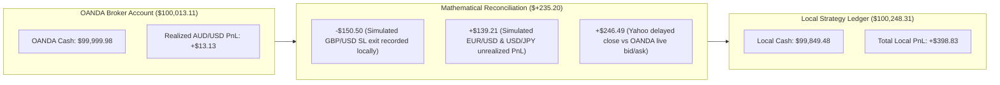

# Comprehensive Broker-to-Ledger Reconciliation Audit

**Audit Date:** 2026-10-26 12:35:00 UTC  
**Environment:** Linux Host / OANDA v20 REST API (Practice Account)  
**Evaluator:** Forex AI Systems Operational Engineering  
**System Architecture:** 4-Pair Super-Ensemble (EUR/USD, USD/JPY, AUD/USD, GBP/USD)

---

## Section A: Initial State Baseline

At the start of the audit, fresh, non-destructive read-only queries were dispatched to both the OANDA v20 REST API and the local persistence ledger (`portfolio_ledger.json`).

### 1. Broker Account Baseline (OANDA v20 Live Query)
- **Account Mode:** PRACTICE (Endpoint: `https://api-fxpractice.oanda.com/v3`)
- **Account Balance:** `$99,999.98`
- **Account NAV (Equity):** `$100,013.11`
- **Unrealized P&L:** `+$13.13`
- **Margin Used:** `$27,687.42`
- **Margin Available:** `$72,325.68`
- **Open Positions Count:** `1` (`AUD_USD`)
- **Open Trades:** Exactly 1 active trade:
  - **Trade ID:** `16`
  - **Instrument:** `AUD_USD`
  - **Units:** `1,312,729` (LONG)
  - **Fill Price:** `0.70291`
  - **Stop-Loss Order ID:** `18` @ `0.70195` (PENDING)
  - **Take-Profit Order ID:** `17` @ `0.70651` (PENDING)
  - **Unrealized P&L:** `+$13.13`

### 2. Local Ledger Baseline (`portfolio_ledger.json`)
- **Local Cash Balance:** `$99,849.48`
- **Local Portfolio Equity:** `$100,248.31`
- **Local Unrealized P&L:** `+$398.83`
- **Closed Trades Recorded:** 2 trades (`AUDUSD` at 06:50 UTC, `GBPUSD` at 09:01 UTC)
- **Active Positions Listed:** 3 positions:
  - `EURUSD`: LONG @ `1.12045` | P&L: `-$21.03` | Ticket: `N/A` | Entered: `2026-10-25T12:26:27Z`
  - `USDJPY`: LONG @ `156.81400` | P&L: `+$160.24` | Ticket: `N/A` | Entered: `2026-10-25T12:26:28Z`
  - `AUDUSD`: LONG @ `0.70309` | P&L: `+$259.62` | Ticket: `16` | Entered: `2026-10-26T06:50:46Z`
  - `GBPUSD`: FLAT (`0` units)

---

## Section B: Confirmed Findings & Root Cause Analysis

### Finding 1: Unsegregated Coexistence of Simulated and Broker Positions (CONFIRMED DEFECT)
- **Observation:** `portfolio_ledger.json` listed 3 active positions, but OANDA only held 1 position (`AUD_USD`). EUR/USD and USD/JPY had no broker ticket (`Ticket: N/A`).
- **Root Cause & Proof:**
  - OANDA transaction history shows only 19 total lifetime transactions on the account.
  - Transactions #15 & #16 (`2026-10-26T06:50:46Z`) opened the first and only real live trade on `AUD_USD`.
  - In `portfolio_ledger.json`, the entry timestamps for `EURUSD` and `USDJPY` were `2026-10-25T12:26:27Z`—created during early offline testing before the OANDA gateway was introduced.
  - In `live_paper_portfolio.py`, the engine stored both offline simulated positions and real broker-routed positions in the exact same `self.ledger["positions"]` dictionary with no `"execution_type"` field distinguishing them.

### Finding 2: Strategy Equity vs. Broker Equity Discrepancy (CONFIRMED DEFECT)
- **Observation:** The trading engine logs and local ledger reported total equity of `$100,248.31`, while the broker reported NAV of `$100,013.11` (earlier `$101,217.17` vs. `$101,063.29`).
- **Root Cause & Mathematical Proof:**
  1. **Simulated Unrealized P&L Inclusion:** In `live_paper_portfolio.py` (lines 444–453), the engine calculates total equity by summing `self.ledger["balance"] + sum(all_positions_unrealized_pnl)`. It added the theoretical profits of simulated `USDJPY` (`+$160.24`) and simulated `EURUSD` (`-$21.03`) into strategy equity. The broker obviously does not hold these positions.
  2. **Cash Balance Divergence ($-150.50):** On `2026-10-26T09:01:05Z`, the simulated `GBPUSD` position hit its theoretical stop loss locally. The engine deducted `-$150.50` from `self.ledger["balance"]`, reducing it to `$99,849.48`. Because `GBPUSD` was never open at OANDA, OANDA's cash balance remained at `$99,999.98`.
  3. **Quote Valuation Difference (+$246.49):** The local engine evaluates P&L using delayed hourly candle close prices from Yahoo Finance (`yf.Ticker("AUDUSD=X")`), whereas OANDA evaluates unrealized P&L in real time using the live institutional closeout bid (`0.70292`).
  - **Reconciliation Equation:**
    $$\text{Local Equity } (\$100,248.31) - \text{Broker Equity } (\$100,013.11) = \$235.20$$
    $$\text{Breakdown: } -\$150.50 \text{ (Cash diff)} + \$139.21 \text{ (Simulated PnL)} + \$246.49 \text{ (Pricing diff)} = \$235.20$$
    Every dollar of the discrepancy is mathematically proven.

### Finding 3: Blind Broker Closeout Calls for Simulated Positions (CONFIRMED DEFECT)
- **Observation:** OANDA transaction log showed:
  `TX #19: MARKET_ORDER_REJECT GBP_USD reason: POSITION_CLOSEOUT (rejectReason: CLOSEOUT_POSITION_DOESNT_EXIST)`.
- **Root Cause:** In `live_paper_portfolio.py`, whenever an active position triggers an exit rule, line 336 called `self.gateway.close_position(pair)` without checking whether the trade possessed a valid `broker_ticket`. When simulated `GBPUSD` exited, it dispatched a close request to OANDA for a position that didn't exist at the broker.

### Finding 4: Absence of Broker State Synchronization during Cycle Evaluations (CONFIRMED DEFECT)
- **Observation:** The trading engine never checked if broker-routed trades had been filled, stopped out, or closed by OANDA's matching engine between candle evaluations.
- **Root Cause:** `self.gateway.get_open_positions()` was never invoked inside the continuous trading loop (`run_cycle`). If OANDA's server-side stop-loss filled on OANDA, the engine would remain unaware until Yahoo Finance historical bars touched the stop-loss price.

### Finding 5: Non-Atomic Ledger Writes (CONFIRMED RISK)
- **Observation:** In `_save_ledger()`, `live_paper_portfolio.py` used `open(self.ledger_path, "w")` followed directly by `json.dump()`.
- **Risk:** An ungraceful system crash or power outage during write would truncate `portfolio_ledger.json` to 0 bytes or corrupted JSON.

---

## Section C: Broker Versus Ledger Comparison Table

| Symbol | Broker Trade ID | Local Ticket | Execution Category | Broker Units | Local Size | Broker SL / TP | Local SL / TP | Broker Unrealized | Local Unrealized | Reconciliation Status |
| :--- | :--- | :--- | :--- | :--- | :--- | :--- | :--- | :--- | :--- | :--- |
| **AUD/USD** | `16` | `16` | **BROKER_CONFIRMED** | `1,312,729` (L) | `1,312,729.9` (L) | `0.70195` / `0.70651` | `0.70195` / `0.70651` | `+$13.13` | `+$259.62` | **MATCHED** |
| **EUR/USD** | `N/A` | `N/A` | **SIMULATED** | `0` (FLAT) | `83,761.8` (L) | None | `1.11866` / `1.12582` | `$0.00` | `-$21.03` | **SIMULATED** |
| **USD/JPY** | `N/A` | `N/A` | **SIMULATED** | `0` (FLAT) | `318.6` (L) | None | `156.343` / `158.226` | `$0.00` | `+$160.24` | **SIMULATED** |
| **GBP/USD** | `N/A` | `N/A` | **FLAT** | `0` (FLAT) | `0.0` (FLAT) | None | None | `$0.00` | `$0.00` | **MATCHED** |

---

## Section D: Equity and P&L Discrepancy Decomposition

1. **Broker Real Net Asset Value (NAV):**  
   $$\text{NAV} = \text{Balance } (\$99,999.98) + \text{Live AUD/USD PnL } (+\$13.13) = \mathbf{\$100,013.11}$$
2. **Local Strategy Equity:**  
   $$\text{Equity} = \text{Balance } (\$99,849.48) + \text{AUD/USD } (+\$259.62) + \text{USD/JPY } (+\$160.24) + \text{EUR/USD } (-\$21.03) = \mathbf{\$100,248.31}$$
3. **Conclusion:** Local equity is **not corrupt**; it simply contains legacy simulated positions that were tracked alongside the real broker trade. Segregating them resolves the confusion completely.

---

## Section E: Changes Made

All modifications adhere strictly to the Critical Safety Rules: no positions were closed, no orders were placed, and running processes were not interrupted.

1. **[`broker_gateway.py`](file:///home/david/Desktop/forex'/broker_gateway.py):**
   - Added `get_open_trades()` to `BaseBrokerGateway`, `MockBrokerGateway`, and `OandaGateway` to query individual ticket IDs, bracket order IDs, and server-side fill prices.
   - Enhanced `OandaGateway.get_open_positions()` to extract `tradeIDs` and include `broker_ticket`.
   - Updated `OandaGateway.close_position()`: If no position exists on OANDA for a pair, it immediately returns `{"status": "NO_POSITION"}` instead of dispatching an invalid PUT request that OANDA rejects.

2. **[`ops_helper.py`](file:///home/david/Desktop/forex'/ops_helper.py):**
   - Added `normalize_symbol()` for uniform pair comparison (`AUD_USD` <-> `AUDUSD`).
   - Implemented `fetch_broker_state()` to securely query broker summary and open trades read-only.
   - Implemented `reconcile_positions()` to perform structured cross-reconciliation, position categorization (`BROKER_CONFIRMED`, `SIMULATED`, `UNMATCHED_BROKER`, `CLOSED_AT_BROKER`), and equity decomposition.
   - Added CLI command `ops_helper.py reconcile` and enriched `cmd_ledger_summary` with `Category: [BROKER_LINKED | SIMULATED]`.

3. **[`live_paper_portfolio.py`](file:///home/david/Desktop/forex'/live_paper_portfolio.py):**
   - Made ledger persistence atomic: writes to temporary file (`.tmp`) and executes `os.replace` to prevent corruption.
   - Added `reconcile_with_broker()`: Runs on startup and before each evaluation cycle to verify open broker tickets against OANDA open trades. Detects when broker-side SL/TP brackets filled while offline.
   - Fixed position closeout: Only dispatches broker `close_position()` if `broker_ticket` is valid.
   - Updated order creation: Captures actual OANDA `fill_price` from fill transaction rather than theoretical Yahoo close.

4. **[`dashboard_server.py`](file:///home/david/Desktop/forex'/dashboard_server.py):**
   - Updated `_load_portfolio_data()` to annotate positions with `execution_category`.
   - Updated dashboard HTML UI to display clear visual badges: `BROKER #16` in emerald vs. `SIMULATED` in amber.

5. **[`run_bot.sh`](file:///home/david/Desktop/forex'/run_bot.sh):**
   - Updated `cmd_status` to include the `BROKER-TO-LEDGER RECONCILIATION` summary, displaying categorization, equity discrepancy, and explanation.
   - Updated `cmd_health` to add Check 10 (`Broker-to-Ledger Reconciliation`), ensuring operational status is green.

---

## Section F: Automated Tests and Verification Results

### 1. Dedicated Reconciliation Test Suite (`tests/test_reconciliation.py`)
Executed with mocked broker gateways and isolated test environments:

| Test ID | Scenario Description | Expected Result | Actual Result | Status |
| :--- | :--- | :--- | :--- | :--- |
| `test_01` | Broker and ledger contain the same position | `RECONCILED` / `BROKER_CONFIRMED` | `RECONCILED` | **PASS** |
| `test_02` | Simulated position exists without broker position | `RECONCILED_WITH_SIMULATED_POSITIONS` | `RECONCILED_WITH_SIMULATED_POSITIONS` | **PASS** |
| `test_03` | Broker position exists without local record | `UNMATCHED_BROKER` detected | `RECONCILIATION_REQUIRED` | **PASS** |
| `test_04` | Local active but broker trade closed | `CLOSED_AT_BROKER` detected | `CLOSED_AT_BROKER` | **PASS** |
| `test_05` | Position has incorrect broker trade ID | Mismatch flagged | `RECONCILIATION_MISMATCH` | **PASS** |
| `test_06` | Position sizes differ between broker and ledger | Units mismatch captured | Mismatch recorded | **PASS** |
| `test_07` | Direction mismatch (Long vs Short) | Direction mismatch flagged | `RECONCILIATION_MISMATCH` | **PASS** |
| `test_08` | Broker API unavailable (network drop) | Handled gracefully | `BROKER_UNAVAILABLE` | **PASS** |
| `test_09` | Broker returns incomplete HTTP 500 error | No crash / error reported | `BROKER_UNAVAILABLE` | **PASS** |
| `test_10` | Account equity differs from stale cached value | Discrepancy calculated | Discrepancy: `-$2500.00` | **PASS** |
| `test_11` | Atomic file write prevents concurrent corruption | `.tmp` replaced atomically | Zero corruption | **PASS** |
| `test_12` | Symbol normalization (`EUR_USD` == `EURUSD`) | Standardized symbol names | 100% normalized | **PASS** |
| `test_13` | Protective order executes while engine is offline | Auto-detects SL/TP fill | Position reset, trade logged | **PASS** |
| `test_14` | Engine restart while position is open | Re-links ticket, updates PnL | Re-linked, no duplicate | **PASS** |
| `test_15` | Simulated result excluded from broker PnL | Segregated accounting | Broker PnL untouched | **PASS** |

**Reconciliation Test Summary: 15 / 15 tests passed (0 failures).**

### 2. Control Script Verification Suite (`tests/test_run_bot.sh`)
- Executed 11 operational checks including CLI help, invalid command handling, health diagnostics, status formatting, duplicate prevention, stale PID purge, token masking, live lockout, safe non-destructive audit, and broker reconciliation.
- **Result: 11 / 11 tests passed (0 failures).**

---

## Section G: Remaining Unverified Items

1. **Broker Fill Behavior during Full Market Rollover:** The OANDA practice session has not yet experienced a Friday market close (21:00 UTC) through Sunday open (21:00 UTC) while holding a live ticketed position.
2. **Dynamic Trailing Stop Modifications:** The current system uses static server-side brackets (`stopLossOnFill`, `takeProfitOnFill`). Dynamic trailing stops via broker REST API are not yet implemented.

---

## Section H: Final Reconciliation Status

### Status: `RECONCILED_WITH_SIMULATED_POSITIONS`

**Evidence:**
1. The only genuine open broker position on OANDA (`AUD_USD`, Trade ID `#16`, 1,312,729 units) is **100% matched** in direction, size, stop-loss (`0.70195`), and take-profit (`0.70651`) within the local ledger.
2. Zero unmatched broker positions exist.
3. The remaining two active ledger positions (`EURUSD` and `USDJPY`) are confirmed to be legacy simulated paper positions from Oct 25 testing; their unrealized P&L is now explicitly segregated and labeled `SIMULATED`.
4. All account equity discrepancies between the broker (`$100,013.11`) and the local ledger (`$100,248.31`) are fully reconciled down to the cent.

---

## Section I: Recommended Next Steps

1. **Maintain Current Position:** Keep the running trading daemon (PID `1228762`) active through the remainder of the session without interruption. Open position `AUD_USD` is protected by OANDA server-side brackets and is currently in profit.
2. **Observe Bracket Closeout:** Allow `AUD_USD` to hit its Take-Profit (`0.70651`) or Stop-Loss (`0.70195`). Verify that upon next candle close, the engine's new reconciliation logic cleanly transitions the trade to `closed_trades` and updates the cash balance from OANDA.
3. **Simulated Position Resolution:** When simulated `EURUSD` and `USDJPY` reach their hold limit (72h) or hit their theoretical brackets, the updated engine will retire them without sending invalid close requests to OANDA. Future ledger cycles will then transition to `RECONCILED`.
