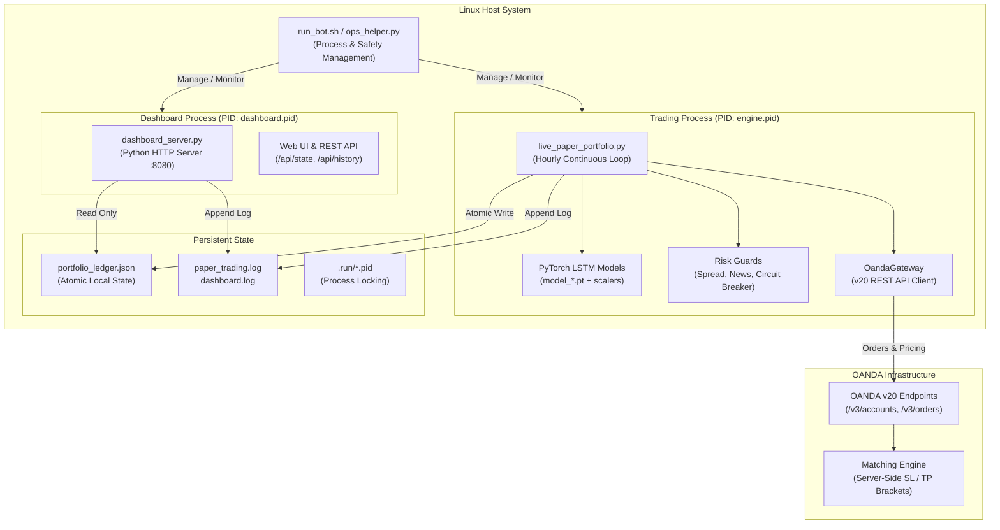

# AI Forex Trading System: Production Operations Manual

This operations manual provides comprehensive guidance for deploying, managing, monitoring, and troubleshooting the multi-pair AI Forex Trading System on Linux.

---

## Section A: Architecture Overview

The system is a production-grade automated trading platform running 4 neural-network models across major currency pairs (**EUR/USD, USD/JPY, AUD/USD, GBP/USD**), interfacing directly with OANDA via the v20 REST API.



### Core Components

1. **Trading Engine (`live_paper_portfolio.py`)**:
   - Hourly evaluation cycle aligned to candle closes (XX:01 UTC).
   - Generates multi-pair predictions via PyTorch LSTM models.
   - Evaluates risk thresholds before dispatching orders.
   - Records state atomically to `portfolio_ledger.json`.

2. **Broker Gateway (`broker_gateway.py`)**:
   - Abstract interface supporting `OandaGateway` (v20 REST API) and `MockBrokerGateway` (local sandbox).
   - Dispatches orders with broker-native stop-loss (`stopLossOnFill`) and take-profit (`takeProfitOnFill`) brackets.
   - Strictly enforces precision, units format, and bracket validity.

3. **Risk & Safety Guards (`risk_guards.py`)**:
   - `SpreadGuard`: Rejects trade execution if market bid-ask spread exceeds pair thresholds.
   - `NewsShield`: Blocks new entries around high-impact economic releases.
   - `DailyCircuitBreaker`: Halts trading if daily drawdown hits predefined risk limit.
   - `WebhookNotifier`: Dispatches real-time risk alerts.

4. **Web Dashboard (`dashboard_server.py`)**:
   - Standalone Python `http.server` running on port 8080.
   - Reads `portfolio_ledger.json` in read-only mode to render performance, active positions, and recent trades.

5. **Operational Control Suite (`run_bot.sh` & `ops_helper.py`)**:
   - POSIX-compliant process manager ensuring deterministic lifecycle management.
   - Enforces 3-layer live-trading locks, prevents duplicate instances, redacts secrets, and runs non-destructive health diagnostics.

---

## Section B: Quick Start Guide

### 1. Initial Setup

Configure environment settings from the template:

```bash
cp .env.example .env
chmod 600 .env broker_config.json
```

Verify that all Python virtual environment dependencies and model checkpoints are valid:

```bash
./run_bot.sh health
```

### 2. Start the System

Launch the trading engine and dashboard:

```bash
./run_bot.sh start
```

### 3. Check System Status

Inspect live process state, broker account data, and open positions:

```bash
./run_bot.sh status
```

### 4. Monitor Logs

Stream real-time trading engine activity:

```bash
./run_bot.sh logs -f
```

### 5. Access Web Dashboard

Open your web browser and navigate to:
```
http://localhost:8080
```

### 6. Stop the System

Gracefully shut down all trading processes:

```bash
./run_bot.sh stop
```

---

## Section C: Commands Reference

The control script `./run_bot.sh` provides deterministic lifecycle management.

### Commands

| Command | Usage | Description | Exit Codes |
| :--- | :--- | :--- | :--- |
| `start` | `./run_bot.sh start` | Verifies environment, safety locks, and starts engine & dashboard | `0` = Success<br/>`1` = Startup Error<br/>`2` = Safety Lockout |
| `stop` | `./run_bot.sh stop` | Gracefully terminates engine and dashboard processes | `0` = Stopped<br/>`1` = Stoppage Error |
| `status` | `./run_bot.sh status` | Displays live process state, broker-reported stats, and ledger positions | `0` = Clean<br/>`1` = Read Error |
| `logs` | `./run_bot.sh logs [options]` | Displays logs with automatic secret redaction | `0` = Success<br/>`1` = Log Not Found |
| `health` | `./run_bot.sh health` | Runs 9 non-destructive health and connectivity checks | `0` = All Passed<br/>`1` = Diagnostic Failure |
| `help` | `./run_bot.sh help` | Prints available commands and usage guide | `0` = Success |
| *(interactive)* | `./run_bot.sh` | Launches text-based operational menu | `0` = Exit |

### Log Options

- `-n <lines>`: Number of lines to display (default: 50).
  ```bash
  ./run_bot.sh logs -n 100
  ```
- `-f`, `--follow`: Stream logs continuously in real-time.
  ```bash
  ./run_bot.sh logs -f
  ```
- `--dashboard`: Stream dashboard server logs instead of trading logs.
  ```bash
  ./run_bot.sh logs --dashboard -f
  ```

---

## Section D: Practice vs. Live Trading Safety

To prevent accidental live capital deployment, the system implements a strict **3-Layer Safety Architecture**:

```
Layer 1: broker_config.json -> "environment": "live"
                            +
Layer 2: .env -> ALLOW_LIVE_TRADING=true
                            +
Layer 3: run_bot.sh -> Pre-Flight Lock Verification (Exit Code 2 on Mismatch)
```

### Safety Principles

1. **No Implicit Fallback:** The launcher never falls back from practice to live, nor from mock to live.
2. **Double Confirmation:** Even if `broker_config.json` specifies `"environment": "live"`, `run_bot.sh` will **refuse to execute** with exit code `2` unless `ALLOW_LIVE_TRADING=true` is explicitly set in `.env`.
3. **Ambiguity Rejection:** If `broker_config.json` contains invalid, missing, or unrecognized environments, the engine halts immediately.
4. **Visual Prominence:** When running in live mode, status displays an explicit high-visibility warning:
   ```
   Mode Security: [LIVE] REAL MONEY TRADING
   WARNING: REAL CAPITAL AT RISK (Live Mode Authorized)
   ```

---

## Section E: Process Management and Concurrency

### PID Tracking & Validation

Process IDs are stored in `.run/`:
- `.run/engine.pid`: Trading engine process ID.
- `.run/dashboard.pid`: Web dashboard process ID.

To prevent issues with stale PID files after system reboots or ungraceful shutdowns, `run_bot.sh` validates PIDs using two criteria:
1. **PID Existence:** `kill -0 "$pid"`
2. **Executable & Command Verification:**
   - Reads `/proc/$pid/exe` to confirm it points to a Python interpreter.
   - Reads `/proc/$pid/cmdline` to confirm the script name (`live_paper_portfolio.py` or `dashboard_server.py`).
   - Reads `/proc/$pid/cwd` to confirm the process belongs to this exact project directory.

Stale PID files are automatically detected, reported, and purged.

### Duplicate Prevention

When `./run_bot.sh start` is executed, it inspects active processes. If an engine instance is already running for this directory, startup is blocked with:
```
DUPLICATE PREVENTED: Trading engine is already running (PID: XXXXX).
```

### Shutdown Sequence

Executing `./run_bot.sh stop`:
1. Sends `SIGTERM` to the trading engine.
2. Waits up to `SHUTDOWN_TIMEOUT` seconds (default: 15s) for the process to complete its current loop iteration and persist state.
3. If the process does not terminate within the timeout, `SIGKILL` is issued as a last resort.
4. Cleans up `.run/*.pid` files upon successful termination.

---

## Section F: Broker Interaction and Position Safety

### Crucial Safety Rule: Stopping the Software Never Liquidates Broker Positions

When `./run_bot.sh stop` is executed:
- The local Python process terminates.
- **Open positions on OANDA remain open.**
- **Protective Stop-Loss and Take-Profit orders remain active at OANDA.**

Because every trade submitted by `OandaGateway` includes server-side `stopLossOnFill` and `takeProfitOnFill` specifications, **your protection lives on OANDA's matching engines**, not on your local machine. If your server loses power or internet, the broker will still trigger your stop loss or take profit automatically.

### Crash Recovery & Restart

When restarting the bot after an interruption:
1. `live_paper_portfolio.py` reads `portfolio_ledger.json`.
2. Existing positions recorded in the ledger remain intact.
3. Active OANDA positions with existing broker tickets are maintained.
4. The bot resumes hourly cycle evaluations without opening duplicate trades.

---

## Section G: Risk Controls and Failsafes

The system integrates four autonomous risk guards (`risk_guards.py`) evaluated prior to any order submission:

### 1. SpreadGuard
- **Purpose:** Prevents trading during periods of liquidity drought or spread spikes.
- **Thresholds:**
  - EUR/USD: Max 1.8 pips
  - GBP/USD: Max 2.5 pips
  - USD/JPY: Max 2.0 pips
  - AUD/USD: Max 2.5 pips
- **Action:** Rejects trade entry if current spread exceeds threshold; logs warning and retries on next candle.

### 2. NewsShield
- **Purpose:** Protects capital against slippage during major macroeconomic data releases (e.g., US NFP, CPI, FOMC rate decisions).
- **Action:** Restricts new order entries 15 minutes before and 30 minutes after scheduled high-impact events.

### 3. DailyCircuitBreaker
- **Purpose:** Catastrophic portfolio loss prevention.
- **Threshold:** Maximum daily drawdown of 2.0% of portfolio equity.
- **Action:** If triggered, blocks all new order creation for the remainder of the trading day.

### 4. WebhookNotifier
- **Purpose:** Immediate operator alerts on critical events (trade execution, circuit breaker trip, API errors).

---

## Section H: Configuration Reference

### Environment Variables (`.env`)

| Variable | Default | Description |
| :--- | :--- | :--- |
| `PYTHON_BIN` | `./env/bin/python` | Path to Python interpreter |
| `PID_DIR` | `./.run` | Directory for process ID files |
| `LOG_DIR` | `.` | Directory for log outputs |
| `CONFIG_FILE` | `./broker_config.json` | Path to broker configuration file |
| `LEDGER_FILE` | `./portfolio_ledger.json` | Path to portfolio state ledger |
| `DASHBOARD_PORT`| `8080` | Port for web dashboard HTTP server |
| `SHUTDOWN_TIMEOUT`| `15` | Seconds to wait for graceful termination |
| `ALLOW_LIVE_TRADING`| `false` | Master safety lock for live capital execution |

### Broker Configuration (`broker_config.json`)

```json
{
  "broker": "oanda",
  "environment": "practice",
  "oanda": {
    "api_token": "YOUR_OANDA_API_TOKEN",
    "account_id": "YOUR_OANDA_ACCOUNT_ID",
    "base_url_practice": "https://api-fxpractice.oanda.com",
    "base_url_live": "https://api-fxtrade.oanda.com"
  }
}
```

---

## Section I: Secret Management and Security

### Protection Rules

1. **Version Control Exclusion:**
   - Both `.env` and `broker_config.json` are registered in `.gitignore`.
   - Never commit API credentials to Git repositories.

2. **File Permissions:**
   - Enforce strict owner-only read/write permissions on configuration files:
     ```bash
     chmod 600 .env broker_config.json
     ```

3. **Automatic Log & Terminal Redaction:**
   - All output displayed via `./run_bot.sh status`, `./run_bot.sh health`, and `./run_bot.sh logs` passes through the `ops_helper.py mask_stdin` filter.
   - Any string matching OANDA token patterns or Bearer headers is masked (`***-REDACTED-***`).
   - Account IDs are masked to show only prefix and suffix (e.g., `101-001-***-001`).

4. **Web Dashboard Isolation:**
   - `dashboard_server.py` serves state only from `portfolio_ledger.json`.
   - Broker credentials and API tokens are never loaded into the dashboard server process or transmitted to client browsers.

---

## Section J: Monitoring and Health Checks

Execute automated diagnostics at any time:

```bash
./run_bot.sh health
```

### The 9 Health Checks

1. **Python Virtual Environment:** Confirms interpreter exists and is executable.
2. **Required Dependencies:** Verifies PyTorch, NumPy, Pandas, Scikit-Learn, TA, Requests, and yfinance are installed.
3. **AI Models & Scalers:** Confirms presence of all 4-pair LSTM checkpoints (`model_*.pt`) and scalers (`scaler_*.pkl`).
4. **Configuration & Safety Mode:** Validates JSON syntax, broker endpoints, and confirms `ALLOW_LIVE_TRADING` safety lock.
5. **Process State & Duplicate Check:** Detects running instances and flags rogue duplicate processes.
6. **Dashboard Availability:** Confirms HTTP 200 response on `http://localhost:8080`.
7. **Broker API Connectivity:** Performs read-only authentication check against OANDA v20 REST endpoints.
8. **Log & PID Storage Writability:** Confirms write permissions for `.run/` and project log files.
9. **Portfolio Ledger File:** Verifies structural integrity of `portfolio_ledger.json`.

---

## Section K: Troubleshooting Guide

### 1. "STARTUP FAILED: Missing required project file"
- **Cause:** One of the core system files was moved or renamed.
- **Remedy:** Ensure `live_paper_portfolio.py`, `dashboard_server.py`, `broker_gateway.py`, `risk_guards.py`, and `ops_helper.py` exist in the project directory.

### 2. "DUPLICATE PREVENTED: Trading engine is already running"
- **Cause:** An engine process is already active.
- **Remedy:** Check running processes using `./run_bot.sh status`. If necessary, run `./run_bot.sh stop` before restarting.

### 3. "SAFETY LOCKOUT: Configuration specifies 'live' trading"
- **Cause:** `broker_config.json` has `"environment": "live"` but `.env` has not authorized live trading.
- **Remedy:** If live trading is intended, set `ALLOW_LIVE_TRADING=true` in `.env`. If practice trading is intended, set `"environment": "practice"` in `broker_config.json`.

### 4. Broker Connectivity Warning / HTTP 401
- **Cause:** OANDA API token is invalid, expired, or has insufficient permissions.
- **Remedy:** Regenerate API token in the OANDA Developer Portal and update `broker_config.json`.

### 5. Dashboard Port 8080 Already in Use
- **Cause:** Another service on the host is bound to port 8080.
- **Remedy:** Set `DASHBOARD_PORT=8081` (or another free port) in `.env` and restart.

### 6. Corrupted `portfolio_ledger.json`
- **Cause:** Ungraceful host power failure during write.
- **Remedy:** The engine uses atomic rename writes (`.tmp` to `.json`) to prevent partial writes. If corruption occurs, restore from the last automatic backup or re-initialize:
  ```bash
  cp portfolio_ledger.json portfolio_ledger.json.bak
  ```

---

## Section L: Maintenance and Upgrades

### Updating Models & Scalers
1. Gracefully stop the trading system:
   ```bash
   ./run_bot.sh stop
   ```
2. Place newly trained model files (`model_*.pt`) and scaler files (`scaler_*.pkl`) into the project root.
3. Run health verification:
   ```bash
   ./run_bot.sh health
   ```
4. Restart the system:
   ```bash
   ./run_bot.sh start
   ```

### Log Maintenance
Logs do not rotate automatically. To truncate or archive old logs without downtime:
```bash
# Archive engine logs
cp paper_trading.log paper_trading_$(date +%F).log
> paper_trading.log
```

---

## Section M: Incident Response Runbook

### Scenario 1: Engine Crash / Process Terminated
1. Inspect the most recent logs:
   ```bash
   ./run_bot.sh logs -n 50
   ```
2. Verify broker account status:
   ```bash
   ./run_bot.sh status
   ```
3. Run diagnostic checks:
   ```bash
   ./run_bot.sh health
   ```
4. Restart the engine:
   ```bash
   ./run_bot.sh start
   ```

### Scenario 2: Circuit Breaker Tripped (Daily Drawdown Exceeded)
1. Check status and log alerts:
   ```bash
   ./run_bot.sh logs -n 30
   ```
2. Confirm that `DailyCircuitBreaker` has halted new order submissions.
3. Do not override or force trades. Allow the cooldown period to expire at the start of the next trading day.

### Scenario 3: Emergency Position Closeout
If an emergency requires immediate closure of all positions:
1. Stop the trading bot to prevent new order entries:
   ```bash
   ./run_bot.sh stop
   ```
2. Log into the official OANDA Web or Mobile Trading App.
3. Execute "Close All Positions" directly through OANDA's platform.

---

## Section N: Operating Checklist

### Pre-Flight Checklist (Before Starting)
- [ ] Virtual environment dependencies verified (`./run_bot.sh health`).
- [ ] Broker mode confirmed: `practice` vs. `live`.
- [ ] API token validity verified against OANDA endpoint.
- [ ] Model checkpoints (`model_*.pt`) and scalers present.
- [ ] Web dashboard port 8080 available.

### Daily Operational Checklist
- [ ] Run `./run_bot.sh status` to inspect process health and equity curve.
- [ ] Check `./run_bot.sh logs -n 20` for risk guard activations or warnings.
- [ ] Confirm web dashboard reflects accurate open positions.
- [ ] Verify that unrealized PnL is within anticipated volatility bounds.

### Weekly Maintenance Checklist
- [ ] Review system log size and archive if exceeding 50 MB.
- [ ] Reconcile `portfolio_ledger.json` closed trades against official OANDA account statement.
- [ ] Execute automated test suite:
  ```bash
  ./tests/test_run_bot.sh
  ```
